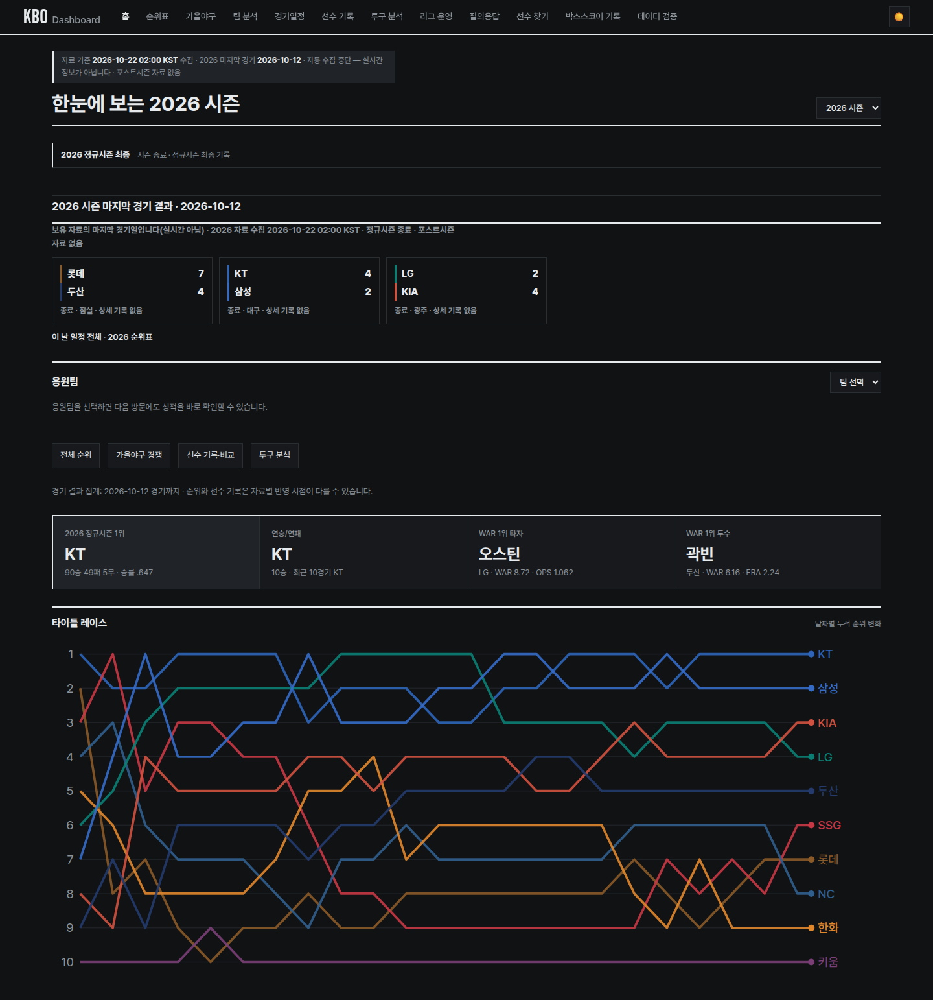
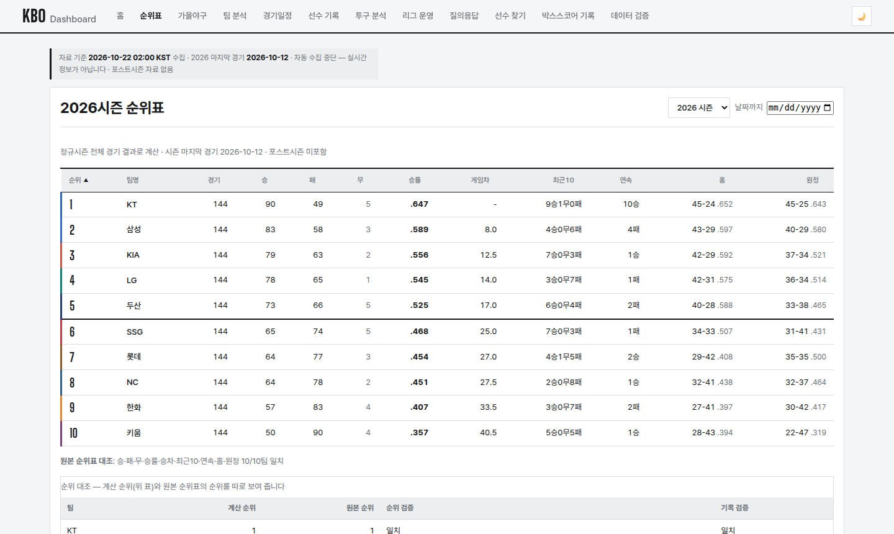
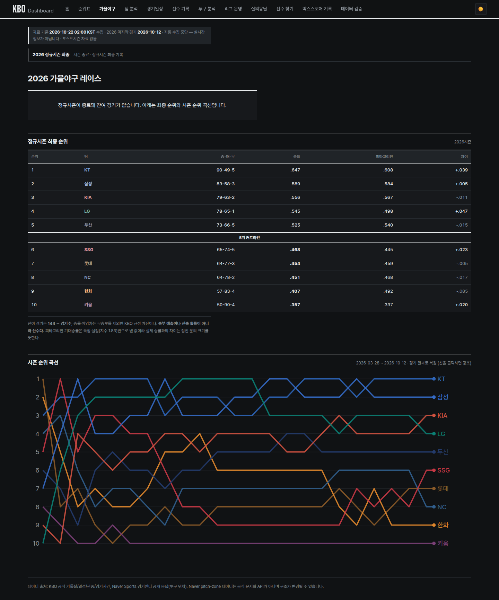
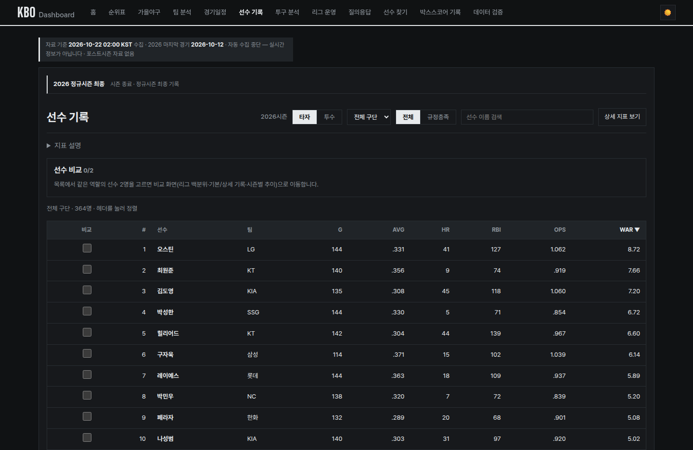
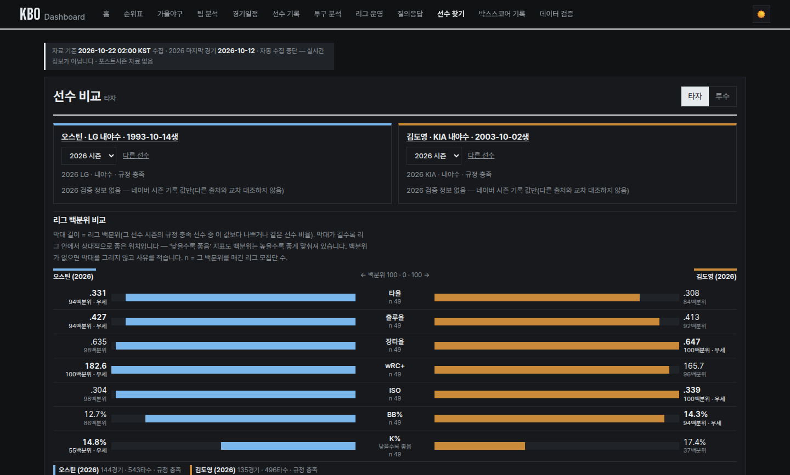
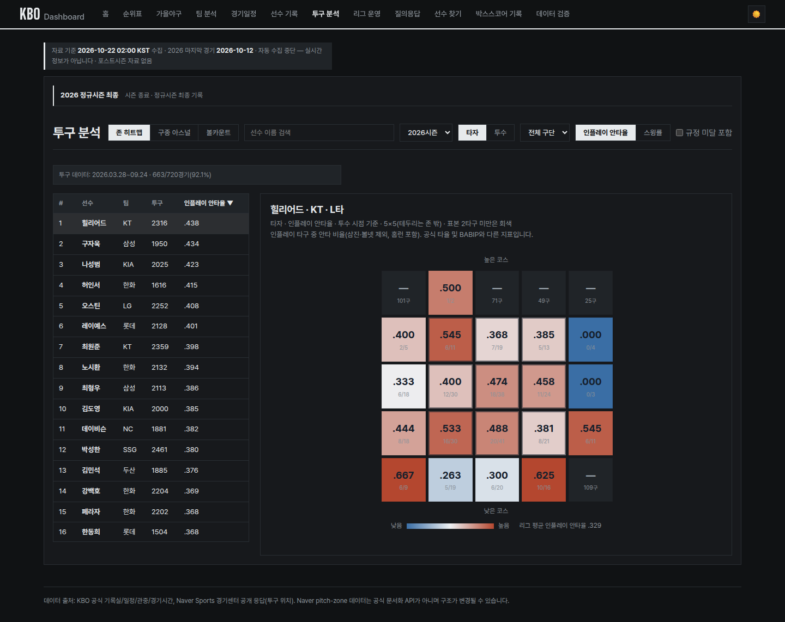
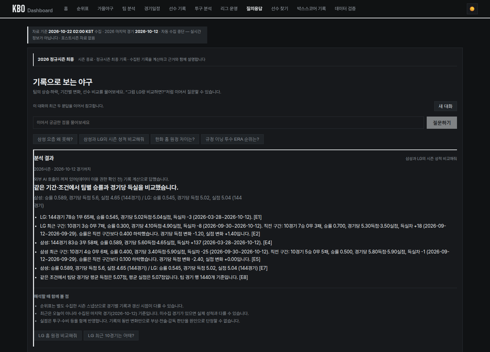

# KBO Stat


KBO 기록을 모아서 한 화면에서 보는 개인용 야구 대시보드입니다.

야구를 보다 보면 "이 타자 요즘 어떻지?", "저 팀 가을야구 가능한가?" 같은 게 바로 궁금해지는데,
그때마다 여러 사이트를 돌아다니기 번거로웠습니다. 경기를 보면서 혼자 바로바로 기록을 찾아볼 수 있게
수집부터 화면까지 직접 만들었습니다.

## 화면



| 순위표 | 가을야구 |
| --- | --- |
|  |  |
| **선수 기록** | **선수 비교** |
|  |  |
| **투구 분석** | **질의응답** |
|  |  |

## 기능

- **홈**: 최근 경기 결과, 시즌 요약, 날짜별 순위 변화, 리더보드, 분포·산점도 차트
- **순위표 / 가을야구**: 시즌 순위와 매직넘버·트래직넘버, 피타고리안 기대승률. 확률 예측은 하지 않고 확정된 계산만 보여 줍니다.
- **팀 분석 / 경기일정**: 팀별 순위 흐름과 월별 성적, 팀 필터가 되는 월간 달력
- **선수 기록 / 선수 찾기 / 선수 비교**: 타자·투수 기록 표, 이름 검색, 두 선수를 리그 백분위로 비교
- **투구 분석**: 투구 좌표를 5×5 격자로 다시 집계한 핫/콜드존, 구종 분포, 볼카운트별 성적
- **질의응답**: "삼성과 LG 비교해줘" 같은 질문에 기록을 계산해서 답하고, 계산에 쓴 근거를 번호로 붙입니다.
- **리그 운영 / 박스스코어 / 데이터 검증**: 관중·경기시간 추이, 경기별 박스스코어, 출처별 데이터 검증 상태

## 만들면서 신경 쓴 것

**데이터가 조용히 깨지지 않게.**
크롤러는 출처 사이트 구조가 바뀌면 에러 없이 빈 결과를 내기 쉽습니다. 그대로 저장하면 멀쩡하던 CSV가 빈 파일로 덮어써집니다.
그래서 모든 CSV 저장이 `csv_guard.py`를 거치게 했습니다. 0행 저장은 거부하고, 행 수가 맞아도 값이 이상하면 정합성 규칙 8개(V-01~08)로 걸러냅니다.

**하루라도 빠지면 복구가 안 되는 데이터.**
KBO 순위 페이지는 오늘 순위만 보여 줍니다. 그날 받아 두지 않으면 그날 순위는 다시 구할 수 없습니다.
실제로 PC가 새벽 갱신 시간에 꺼져 있어서 86일 중 60일이 빈 적이 있습니다.
그래서 스택을 켤 때 그날 갱신이 안 돼 있으면 한 번 따라잡게 했습니다(`scripts/start_kbo.sh`).
CSV는 최신인데 DB만 옛날 데이터로 남는 일이 없도록, DB 적재가 실패하면 갱신 스크립트도 실패로 끝납니다.

**질의응답은 숫자를 지어내지 않게.**
질문을 정해진 분석 항목(승패, 득실, 최근 구간 변화, 선수 순위 등)으로 바꾼 뒤, 숫자는 수집된 기록에서 직접 계산합니다.
AI는 질문을 해석하고 계산 결과를 문장으로 옮기는 데만 씁니다. 답변의 수치에는 계산 근거 번호(E1, E2…)가 붙습니다.
지원하지 않는 분석을 물으면 답을 지어내지 않고, 대신 계산할 수 있는 질문을 되묻습니다.

**수집 권한 확인.**
KBO 사이트의 robots.txt가 승인 없는 자동 수집을 금지한다는 걸 확인한 뒤, 자동 수집과 외부 AI 호출을 기본으로 꺼 두었습니다.
환경 변수로 승인해야만 요청이 나갑니다. 그래서 지금 화면의 데이터는 2026-10-22 수집분에서 멈춰 있습니다.

**테스트.**
백엔드(pytest)와 프론트(테스트·lint·빌드)를 GitHub Actions에서 돌립니다.

## 기술 스택

| 영역 | 기술 |
| --- | --- |
| 데이터 수집 | Python, pandas, requests, BeautifulSoup |
| 백엔드 | FastAPI, SQLAlchemy, PostgreSQL |
| 프론트 | React, Vite, 차트는 SVG로 직접 그림 |
| 인프라 | Docker Compose, nginx, cron |
| AI | OpenAI API (선택) |

## 실행

`kbo-dashboard/.env`를 만든 다음([환경 변수](docs/OPERATIONS.md#환경-변수)) 실행합니다.

```bash
bash scripts/start_kbo.sh
```

`http://127.0.0.1:3000`으로 접속합니다. 데이터 갱신, 백업과 복구, 로컬 개발 방법은 [docs/OPERATIONS.md](docs/OPERATIONS.md)에 있습니다.

## 문서

| 문서 | 내용 |
| --- | --- |
| [PLAN.md](docs/PLAN.md) | 기획서: 범위, 로드맵, 리스크 |
| [REQUIREMENTS.md](docs/REQUIREMENTS.md) | 요구사항과 항목별 검증 결과 |
| [GAP_ANALYSIS.md](docs/GAP_ANALYSIS.md) | 참고한 사이트와 비교해 우리 데이터로 만들 수 있는 것과 없는 것 |
| [IDEAS.md](docs/IDEAS.md) | 아이디어 후보와 채택·기각 이유 |
| [OPERATIONS.md](docs/OPERATIONS.md) | 설치, 실행, 데이터 갱신, 백업과 복구 |

## 개발 방식

AI 코딩 도구로 구현했고, 단계마다 다른 AI 도구로 교차 검증을 받았습니다.
요구사항과 설계, 데이터 검증 기준은 직접 정했습니다. 교차 검증에서 나온 지적은 반영할지 판단한 뒤, 재현 테스트를 붙여서 고쳤습니다.
코드 주석에 나오는 'Codex'는 이 교차 검증에서 나온 지적이라는 뜻입니다.

## 남은 과제

- 팀 비교 화면
- 과거 시즌 확장 (지금 DB는 2020~2026만 적재)

## 데이터 출처

학습과 포트폴리오 목적으로 만든 프로젝트입니다. 데이터는 KBO 공식 사이트, 네이버 스포츠, Statiz에서 가져왔고 권리는 각 출처에 있습니다.
공식 공개 API가 아니라 웹 페이지 응답을 바탕으로 수집하기 때문에, 출처 구조가 바뀌면 크롤러가 멈출 수 있습니다.

구단 엠블럼은 각 구단의 상표라 저장소에 넣지 않았습니다.
